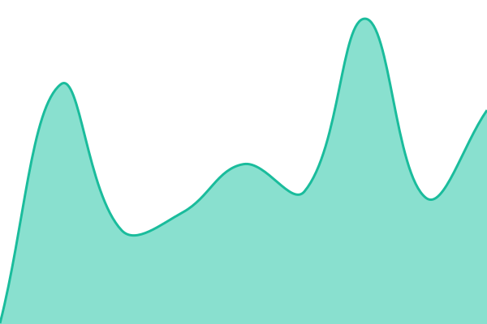
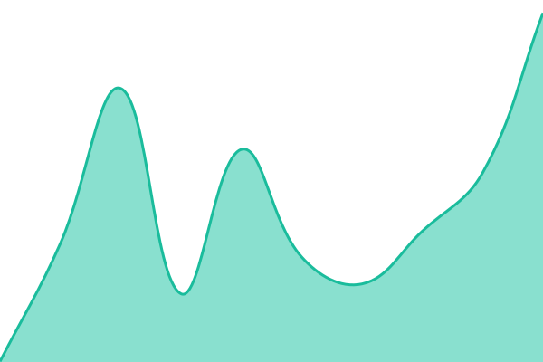
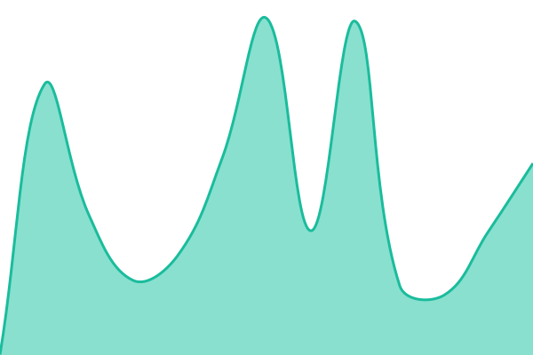
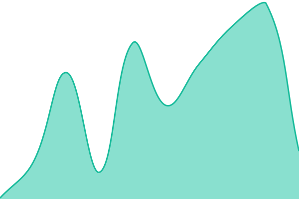
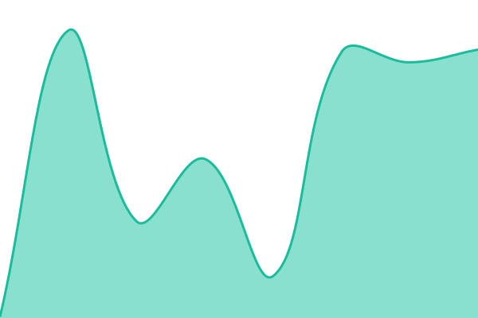

# [📈 Live Status](https://status.meshpool.ai): <!--live status--> **🟧 Partial outage**

This repository contains the open-source uptime monitor and status page for [Paymob](https://paymob.com), powered by [Upptime](https://github.com/upptime/upptime).

With [Upptime](https://upptime.js.org), you can get your own unlimited and free uptime monitor and status page, powered entirely by a GitHub repository. We use [Issues](https://github.com/PaymobAccept/meshpool-status/issues) as incident reports, [Actions](https://github.com/PaymobAccept/meshpool-status/actions) as uptime monitors, and [Pages](https://status.meshpool.ai) for the status page.

<!--start: status pages-->
<!-- This summary is generated by Upptime (https://github.com/upptime/upptime) -->
<!-- Do not edit this manually, your changes will be overwritten -->
<!-- prettier-ignore -->
| URL | Status | History | Response Time | Uptime |
| --- | ------ | ------- | ------------- | ------ |
|  [Website](https://meshpool.ai) | 🟥 Down | [website.yml](https://github.com/PaymobAccept/meshpool-status/commits/HEAD/history/website.yml) | 

 1507ms
     
 | 

<a href="https://status.meshpool.ai/history/website">98.61%</a>
    

|  [Console](https://app.meshpool.ai/auth/login) | 🟩 Up | [console.yml](https://github.com/PaymobAccept/meshpool-status/commits/HEAD/history/console.yml) | 

 294ms
     
 | 

<a href="https://status.meshpool.ai/history/console">99.79%</a>
    

|  [Chat workspace](https://chat.meshpool.ai) | 🟩 Up | [chat-workspace.yml](https://github.com/PaymobAccept/meshpool-status/commits/HEAD/history/chat-workspace.yml) | 

 380ms
     
 | 

<a href="https://status.meshpool.ai/history/chat-workspace">92.85%</a>
    

|  [Sign-in](https://id.meshpool.ai/.well-known/openid-configuration) | 🟩 Up | [sign-in.yml](https://github.com/PaymobAccept/meshpool-status/commits/HEAD/history/sign-in.yml) | 

 106ms
     
 | 

<a href="https://status.meshpool.ai/history/sign-in">99.79%</a>
    

|  [API gateway](https://llm.meshpool.ai/v1/models) | 🟩 Up | [api-gateway.yml](https://github.com/PaymobAccept/meshpool-status/commits/HEAD/history/api-gateway.yml) | 

 149ms
     
 | 

<a href="https://status.meshpool.ai/history/api-gateway">100.00%</a>
    

<!--end: status pages-->

[**Visit our status website →**](https://status.meshpool.ai)

## 📄 License

- Powered by: [Upptime](https://github.com/upptime/upptime)
- Code: [MIT](./LICENSE) © [Anand Chowdhary](https://anandchowdhary.com)
- Data in the `./history` directory: [Open Database License](https://opendatacommons.org/licenses/odbl/1-0/)
